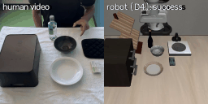
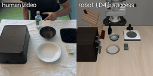
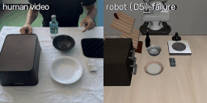
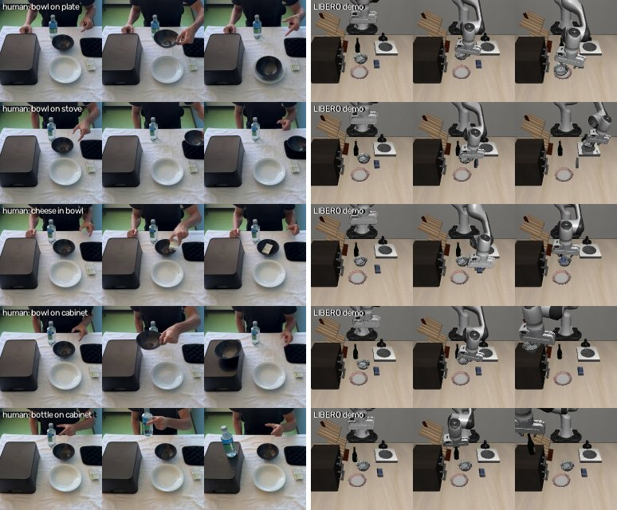

# Behavior cloning across embodiments through aligned human/robot latent actions.

The goal was to teach a robot arm to perform LIBERO tasks only based on self-recorded human demonstrations. The idea then became to align latent representations of human and robot actions. This way, the hope was that the arm would learn general manipulation with robot demos, while allowing the training of novel tasks purely based on human demos. 

## Data:
10 LIBERO tasks were chosen. They were split as:

1. ALIGN (2)
2. TARGET (3)
3. ROBOT-ONLY (5)

Human demonstrations of the ALIGN and TARGET tasks were collected in a home setting. Data from the robot's modality was also prepared for the same ALIGN tasks, and for ROBOT-ONLY tasks, taken from the LIBERO-Goal demonstrations.

| Split | Tasks | Robot demos | Human videos |
|---|---|---|---|
| **TARGET** | bowl on plate, bowl on stove, cream cheese in bowl | never (diagnostics only) | 12 takes each |
| **ALIGN** | bowl on top of cabinet, wine bottle on top of cabinet | 50 each | 12 takes each |
| **ROBOT-ONLY** | push plate to stove, open middle drawer, turn on stove, bottle on rack, open top drawer + bowl inside | 50 each | – |

## Approach:
1. Extract V-JEPA features, 
2. Train TCC on same-task clip pairs to embed task phase, matching human and robot frames on ALIGN.
2. Train a latent action model on all data, with contrastive loss on the two ALIGN embodiments.
3. Train the latent policy on human demos only.
4. Train the decoder on the 7 robot tasks only.  
 


## Takeaway:

- **Works:** a policy trained only on human videos drives the robot on the ALIGN tasks: 39–46/50 and 23–36/50
  successes (policy trained on robot videos: 49/50, 11/50).
- **Fails:** 0/150 on the TARGET tasks. The decoder fails there even with perfect latent actions (1/150), mainly
  because the latent actions are task-specific.

| Policy from human videos, ALIGN task: bowl on cabinet (success) | Policy from human videos, ALIGN task: bottle on cabinet (success) | Policy from human videos, TARGET task: bowl on plate (failure) |
|---|---|---|
|  |  |  |

## Details



60 clips were recorded with home stand-ins (used a box for the cabinet, an oven mitt for the stove). The task segment is cut out automatically (55/60; 5 set by hand). The robot data
are the official teleoperated LIBERO-Goal demos (0–39 for training, 40–49 held out). `splits.py` asserts that no TARGET robot data enters training.

| Component | Input → output | Trained on |
|---|---|---|
| V-JEPA 2 ViT-L (frozen) | 16-frame window → 4×4×1024 feature grid per step | – |
| TCC | feature grid → 128-d "how far through the task" embedding | same-task clip pairs; human-robot pairs from ALIGN only |
| Latent action model | grids at t and t+0.5 s → 16-number code for what changed in between| next-frame prediction on all clips; contrastive loss on TCC-matched human/robot ALIGN pairs |
| Policy | TCC embedding + task ID → code |human videos only |
| Decoder | code + robot state → 10 robot actions | robot demos of ALIGN + ROBOT-ONLY |

At inference: camera → V-JEPA → TCC → policy → decoder → robot. 


## Results

All tests use the same trained components. The TCC embedding, the latent action model and the decoder (trained on
robot demos 0–39 of the 7 ALIGN + ROBOT-ONLY tasks) are trained once and then frozen. Only the policy changes: it is
trained separately for each test, on a different set of videos. D1 uses no policy.

| Test | Question | Trained for this test | Latent actions come from | Tested on | Loop |
|---|---|---|---|---|---|
| **D1** | can the decoder act, given perfect latent actions? | nothing | the latent action model, applied to a recorded robot demo's own frames ("perfect" codes) | that demo's starting state: demos 40–49 of each training task; all 50 demos of each TARGET task *(diagnostic)* | open |
| **D2** | reference: how well does the pipeline do when the videos show the robot itself? | policy, on robot demo videos of the ALIGN tasks (demos 0–39) | the policy, from the live camera | ALIGN tasks | closed |
| **D3** | would TARGET work if the videos showed the robot instead of a human? | policy, on robot demo videos of the TARGET tasks *(diagnostic)* | the policy | TARGET tasks | closed |
| **D4** | do human videos transfer to the robot, on tasks the decoder knows? | policy, on human videos of the ALIGN tasks (takes 1–10) | the policy | ALIGN tasks | closed |
| **D5** | main experiment: can human videos teach the robot tasks it has no robot data for? | policy, on human videos of all 5 recorded tasks | the policy | TARGET tasks | closed |
| mean / random code | does the policy matter, or would any code succeed? | nothing | the average training code, or a random one | both | closed |
| without contrastive loss | is the human-robot alignment needed? | latent action model retrained without it, then the decoder and D4 policy retrained on top | the policy | ALIGN tasks | closed |

*Open loop:* the latent actions are fixed in advance from the recording, and the camera isn't used, so small drifts are
never corrected. *Closed loop:* every 10 steps the robot takes a new camera frame and the policy picks the next latent
action from it. Each closed-loop task runs from LIBERO's 50 fixed starting layouts, and an episode succeeds if LIBERO's
goal check passes within 300 steps. One seed; identical re-runs vary by up to ~7/50.

Each cell is successful episodes / episodes run.

**ALIGN tasks**: the decoder was trained on robot demos of these tasks.

| Test | Policy trained on | bowl on cabinet | bottle on cabinet |
|---|---|---|---|
| D1 | no policy: perfect latent actions from held-out robot demos, open loop | 9/10 | 6/10 |
| D2 | robot videos | 49/50 | 11/50 |
| **D4** | **human videos** | **46/50** | **26/50** |
| D4, two retrainings | human videos | 39/50, 41/50 | 36/50, 23/50 |
| D4 without contrastive loss | human videos | 0/50 | 0/50 |
| mean or random code | no policy | 0/50 | 0/50 |

Human videos transfer: D4 is a little below D2 on the bowl and well above it on the bottle. Without the human-robot
contrastive loss, or without a policy, nothing succeeds.

**TARGET tasks**: no robot data of these tasks was used in training.

| Test | Policy trained on | bowl on plate | bowl on stove | cheese in bowl |
|---|---|---|---|---|
| D1 *(diagnostic)* | no policy: perfect latent actions from TARGET robot demos, open loop | 1/50 | 0/50 | 0/50 |
| D3 *(diagnostic)* | TARGET robot videos | 1/50 | 0/50 | 0/50 |
| **D5** | **human videos** | **0/50** | **0/50** | **0/50** |
| mean or random code | no policy | 0/50 | 0/50 | 0/50 |

On new tasks even perfect latent actions (D1) and robot videos (D3) succeed at most once in 50 episodes. So the
decoder fails before human video plays any role.

## Why it fails on new tasks

**The decoder doesn't transfer to new tasks.** Offline, on held-out demos (`diag_info.py`; translation error of the
predicted movement, lower is better):

| Decoder trained on | error on the 7 tasks | error on TARGET |
|---|---|---|
| the 7 ALIGN + ROBOT-ONLY tasks | 0.023 | 0.102 |
| TARGET demos *(diagnostic)* | 3.4 | 0.030 |
| the 7 tasks, reading raw V-JEPA features of frames t and t+10 *(no latent code)* | 0.013 | 0.037 |
| nothing: always predict the average action | – | 0.187 |

Each decoder fails on the other's tasks: the same code means different arm motions in different tasks. The motion is
still in the V-JEPA features, since a decoder reading them directly transfers almost 3× better (0.037 vs 0.102). The
latent action model encodes it per task because it is only trained to predict how the scene changes, and nothing ties
the same arm motion to the same code across tasks.

**What I tried.** Each row was run and logged; the code has since been removed from this repo to keep it readable.

| Intervention | Motivation | Result (successes /50 per task) | Takeaway |
|---|---|---|---|
| **More robot data:** +83 filtered LIBERO-90 tasks | 7 tasks may be too few motions to generalise from | D1 on TARGET 0/150; D4 fell to 24, 17 | no gain while latent actions are task-specific; weaker human-to-robot transfer |
| **Arm-describing latent actions:** also predict the robot action (LAOM, villa-X), hand/gripper tracks (MT-π), optical flow (LAOF) or feature change (Olaf-World); 18 variants | tie latent actions to arm motion, so a motion gets the same code in every task | offline TARGET error up to 2.4× lower; D4 0–5 for most (best: 17, 37); D5 ≤ 2/150 | describing the arm breaks the human-robot match: hands and grippers move differently (see below) |
| **No latent actions:** policy predicts gripper motion; decoder (with LIBERO-90) maps it to actions | use a motion signal that means the same in every task | with *true* robot motion: TARGET 12, 0, 3; from human videos: D4 0/100, D5 1/150 | the decoder can partly act out new tasks, but the motion can't be obtained from human videos |

**Why describing the arm breaks the human-to-robot transfer.** `diag_handover.py` pairs each moment of the held-out human
ALIGN clips with the robot moment at the same task phase, and checks whether the hand and the gripper move the same way:

| | robot vs robot | human vs robot |
|---|---|---|
| bowl on cabinet: same direction / same grip | 99% / 94% | 70% / 68% |
| bottle on cabinet: same direction / same grip | 97% / 90% | 32% / 50% |

The hand often moves differently from the gripper at the same phase. This suggests the original code transferred
because it encoded what happened in the scene (the bowl rising to the cabinet), which humans and the robot share,
rather than how the arm moved, which they don't.

## Future directions

Mask out the hand and the robot arm, so latent actions describe only what happens to the objects, which looks the
same for both. Then train the decoder on these object-motion codes plus the current frame, with broad robot data
including LIBERO-90 (untested).

## Limitations

- One seed per configuration; closed-loop counts move by up to ~7/50 between identical re-runs. Offline diagnostics
  are single runs.
- Two held-out human takes per task.
- Both ALIGN tasks are "place on the cabinet", so the human-robot pairs cover few motions.
- Home stand-in objects.
- Open-loop replay of the recorded demo actions succeeds in only 457/500 (contact physics isn't reproducible).
- Latent actions from human TARGET videos sit about twice as far from any robot code as those from human ALIGN
  videos, so the human side may fail on TARGET too; this can't be tested while the decoder fails.
- The SmolVLA baseline was not run.

## Usage

```bash
conda env create -f environment.yml && conda activate human-demo-to-libero
export MUJOCO_GL=egl   # headless rendering
```

Data goes in `data/` (not in the repo): the official LIBERO-Goal demos in `data/demos/libero_goal/`, the phone clips
in `data/human/raw/<task>/<task>_NN.mov`. LIBERO-90 demos (`data/demos/libero_90/`) and the MediaPipe hand model
(`data/models/hand_landmarker.task`) are only needed for the diagnostics. Run from the repo root, in this order;
models and results go to `runs/` (D0 to `results/`).

| Script | What it does | Usage |
|---|---|---|
| `splits.py` | checks the task split against LIBERO | `python scripts/splits.py` |
| `d0_replay.py` | D0: replays the demos' recorded actions | `python scripts/d0_replay.py` |
| `ingest_human.py` | crops, mirrors and segments the phone clips | `python scripts/ingest_human.py` (`--selftest` to test) |
| `features.py` | caches V-JEPA 2 features (GPU) | `python scripts/features.py` (`--suite libero_90` for LIBERO-90) |
| `tcc.py` | trains the phase embedding | `python scripts/tcc.py --name main --steps 5000` |
| `lam.py` | trains the latent action model | `python scripts/lam.py --name main` (`--nce 0` turns off the contrastive loss) |
| `decoder.py` | trains the decoder | `python scripts/decoder.py --name main --lam main` |
| `policy.py` | trains a policy: `--source human\|robot`, `--tasks align\|target\|human` | `python scripts/policy.py --name d4 --source human --tasks align` |
| `rollout.py` | D1 (`--mode d1`) or closed loop (`--mode policy`) in LIBERO | `python scripts/rollout.py --name d4 --mode policy --pi d4 --tasks <task> ...` |
| `report.py` | results table from finished rollouts | `python scripts/report.py d1 d4` |
| `preview.py` | replays a saved rollout in a window (any machine with LIBERO) | `python scripts/preview.py --run runs/eval_d4/videos/<episode>.json` |
| `motion.py` | tracks the robot gripper and the human hand (diagnostics) | `python scripts/motion.py` |
| `diag_info.py` | offline decoder tests | `python scripts/diag_info.py` (`--libero90` to add LIBERO-90) |
| `diag_handover.py` | does the human hand move like the gripper at the same phase? | `python scripts/diag_handover.py` |
| `figures.py` | README figures | `python scripts/figures.py` |

`--help` lists every option. Training takes minutes on one GPU with cached features; a 100-episode rollout takes
about 15 minutes.

**References:** V-JEPA 2 ([2506.09985](https://arxiv.org/abs/2506.09985)) · TCC/XIRL ([1904.07846](https://arxiv.org/abs/1904.07846), [2106.03911](https://arxiv.org/abs/2106.03911)) ·
LAOM ([2502.00379](https://arxiv.org/abs/2502.00379)) · villa-X ([2507.23682](https://arxiv.org/abs/2507.23682)) · MT-π ([2501.06994](https://arxiv.org/abs/2501.06994)) ·
LAOF ([2511.16407](https://arxiv.org/abs/2511.16407)) · Olaf-World ([2602.10104](https://arxiv.org/abs/2602.10104)) ·
